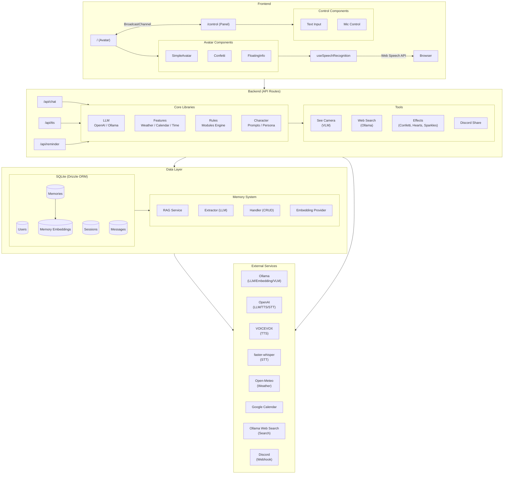

# Architecture Overview

Mirror Mate is a Next.js application that provides an interactive AI avatar for smart mirror displays.

> **Browser Requirement**: Google Chrome is required for voice recognition with the Web Speech API.

## System Architecture



## Directory Structure

```
src/
├── app/                    # Next.js App Router
│   ├── api/
│   │   ├── chat/              # Chat API endpoint
│   │   ├── tts/               # Text-to-speech API
│   │   ├── stt/               # Speech-to-text API and client config
│   │   ├── reminder/          # Reminder API and client config
│   │   ├── memories/          # Memory CRUD API
│   │   ├── characters/        # Character list
│   │   ├── settings/          # User speaker and character settings
│   │   ├── plugins/           # Enabled plugins
│   │   ├── wakeword/          # Wake word config
│   │   ├── vision/analyze/    # Vision test analysis
│   │   ├── voicevox/speakers/ # VOICEVOX speaker list
│   │   └── discord/test/      # Discord webhook test
│   ├── control/
│   │   ├── page.tsx       # Control panel page
│   │   ├── memory/        # Memory management page
│   │   └── vision/        # Vision test page
│   ├── demo/              # Animation demo page
│   └── page.tsx           # Avatar display page
├── components/
│   ├── SimpleAvatar.tsx   # Avatar with lip-sync
│   ├── AvatarAura.tsx
│   ├── Confetti.tsx       # Visual effects
│   ├── FloatingInfo.tsx   # Info cards (weather, calendar)
│   ├── PluginRenderer.tsx # Loads and renders enabled plugins
│   ├── PluginContainer.tsx
│   ├── SettingsDropdown.tsx
│   └── VoicePreviewButton.tsx
├── hooks/
│   ├── useAnimationController.ts
│   ├── useAudioRecorder.ts
│   ├── useAvatarState.ts
│   ├── useCharacterSelector.ts
│   ├── useLongThinkingPulse.ts
│   ├── useReminder.ts
│   ├── useSpeakerSelector.ts
│   ├── useSpeechRecognition.ts
│   └── useWakeWord.ts
├── i18n/
│   └── request.ts         # next-intl locale and messages
└── lib/
    ├── animation/         # Avatar animation state machine
    │   ├── state-machine.ts
    │   ├── transitions.ts
    │   ├── broadcast-adapter.ts # BroadcastChannel integration
    │   ├── config.ts
    │   └── types.ts
    ├── app/               # App configuration and locale
    ├── character/         # Character configuration
    ├── db/                # Database (SQLite + Drizzle ORM)
    │   ├── index.ts       # DB client singleton
    │   └── schema.ts      # Table definitions
    ├── discord/           # Discord webhook client
    ├── embedding/         # Embedding provider
    │   ├── ollama.ts      # Ollama embedding
    │   ├── similarity.ts  # Vector similarity utils
    │   └── types.ts
    ├── features/          # Built-in features
    │   ├── weather/
    │   ├── calendar/
    │   ├── time/
    │   ├── config-loader.ts
    │   └── registry.ts
    ├── llm/               # LLM provider abstraction
    │   ├── openai.ts
    │   ├── ollama.ts
    │   └── types.ts
    ├── memory/            # Memory system
    │   ├── extractor.ts   # LLM-based memory extraction
    │   ├── handler.ts     # Memory CRUD handler
    │   ├── prompts.ts     # Extraction prompt loading
    │   ├── rag.ts         # RAG service
    │   ├── service.ts     # Memory service
    │   └── types.ts
    ├── plugins/           # Plugin system
    │   ├── loader.ts      # Plugin config and manifest loading
    │   ├── registry.ts
    │   └── types.ts
    ├── presets/           # Locale presets
    ├── providers/         # Provider config
    │   ├── config-loader.ts
    │   ├── embedding.ts
    │   ├── stt.ts
    │   └── types.ts
    ├── repositories/      # Data access layer
    │   ├── memory.ts      # Memory repository
    │   ├── user.ts        # User repository
    │   ├── user-settings.ts # User settings repository
    │   └── session.ts     # Session repository
    ├── rules/             # Rule-based workflows
    │   ├── engine.ts
    │   ├── modules.ts
    │   └── types.ts
    ├── search/            # Web search client
    │   └── ollama-search.ts
    ├── stt/               # Speech-to-text providers
    │   ├── openai-whisper.ts
    │   ├── local-whisper.ts
    │   └── types.ts
    ├── tools/             # LLM function calling tools
    │   ├── see-camera.ts
    │   ├── web-search.ts
    │   ├── effects.ts
    │   ├── discord-share.ts
    │   └── types.ts
    └── vlm/               # Vision model providers
        ├── ollama-vlm.ts
        └── types.ts

config/
├── app.yaml               # Language/locale
├── features.yaml          # Built-in feature settings
├── providers.yaml         # LLM, TTS, STT, Embedding, Memory & VLM settings
├── plugins.yaml           # Visual widget plugins
├── presets/
│   └── [lang].yaml        # Locale defaults (timezone, weather, clock, STT)
└── locales/
    └── [lang]/
        ├── character.yaml  # AI personality
        ├── characters.yaml # Selectable characters
        ├── memory.yaml     # Memory extraction prompts
        ├── rules.yaml      # Trigger-based workflows
        └── modules.yaml    # Module definitions

data/
└── mirrormate.[lang].db   # SQLite database file, one per locale
```

## Request Flow

### Voice Input Flow

```
1. User speaks
      │
      ▼
2. Speech recognition (useSpeechRecognition)
   Web Speech API, or POST /api/stt for Whisper
      │
      ▼
3. Wake word check and camera capture
      │
      ▼
4. POST /api/chat
      │
      ├─► User lookup/create (SQLite)
      │
      ├─► Rule matching (rules.yaml)
      │   └─► Execute modules if matched
      │
      ├─► RAG context retrieval
      │   ├─► Get user profile memories
      │   ├─► Embed user message (Ollama)
      │   └─► Semantic search for relevant memories
      │
      ├─► Build system prompt (character + memories + rule or feature context)
      │
      ├─► LLM call (OpenAI/Ollama)
      │   └─► Tool calls (camera, web search, effects, Discord), unless a rule matched
      │
      ├─► Memory extraction (async, non-blocking)
      │   └─► Extract & save new memories from conversation
      │
      └─► Return response + effect + info cards
      │
      ▼
5. Display text + trigger effect
      │
      ▼
6. POST /api/tts
      │
      ▼
7. Play audio with lip-sync
```

### Control Panel Flow

The control panel calls the chat API itself. It uses `BroadcastChannel` to request camera frames, keep the avatar page in sync and have it play the reply, so both pages must run in the same browser.

```
1. User types message in /control
      │
      ▼
2. Camera capture over BroadcastChannel, when vision is enabled
      │
      ▼
3. Broadcast user_message and thinking_start to the avatar page
      │
      ▼
4. POST /api/chat from /control (same pipeline as voice input)
      │
      ▼
5. Broadcast thinking_end, response and play_audio to the avatar page
      │
      ▼
6. Avatar page calls POST /api/tts and plays audio with lip-sync
```

## Key Concepts

### Features

Features provide contextual information (weather, calendar, time) that is injected into the system prompt. They run before the LLM call.

See [Features Documentation](/config/features)

### Rules

Rules define trigger-based workflows. When a user message contains one of a rule's keywords, the rule's modules are executed and results are injected into the context. A match replaces the feature context and disables tools for that request.

See [Rules Documentation](/config/rules)

### Tools

Tools are functions that the LLM can call during the conversation (function calling). Used for looking through the camera, web search, triggering effects and sharing to Discord.

See [Tools Documentation](/config/tools)

### Character

Character configuration defines the AI's personality, speech style, and system prompt.

See [Character Documentation](/config/character)

### Memory

Memory system enables persistent user context through:

- **Profile memories**: User preferences, traits, and persistent information
- **Episode memories**: Recent interactions and events
- **Knowledge memories**: Facts and learned information

The RAG (Retrieval-Augmented Generation) system retrieves relevant memories using semantic search to provide context-aware responses.

See [Memory Documentation](/guide/memory)

### Animation

The avatar uses a finite state machine for animation control with 8 states (IDLE, AWARE, LISTENING, THINKING, SPEAKING, CONFIRMING, ERROR, SLEEP). Each state has distinct visual characteristics including eye shapes, mouth curves, and animation parameters.

See [Animation Documentation](/guide/animation)

### Discord Integration

Share search results, weather info, and other data to Discord for easy access on your phone. With `autoShare.searchResults` enabled, web search results are sent to your Discord channel automatically.

See [Discord Documentation](/guide/discord)
