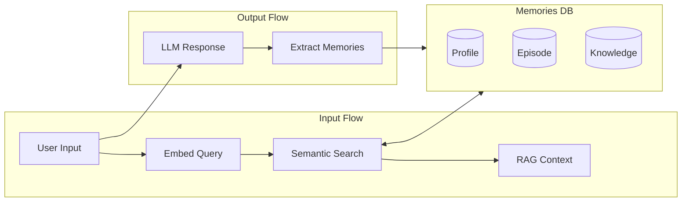

# Memory System

Mirror Mate includes a memory system that enables persistent user context through RAG (Retrieval-Augmented Generation). The system stores user information, extracts memories from conversations, and provides relevant context to the AI.

By default it needs nothing beyond `OPENAI_API_KEY`: OpenAI's `gpt-6-luna` extracts the memories and `text-embedding-3-small` embeds them. The memories themselves stay in the SQLite database on your machine.

## Overview



## Configuration

Memory settings are configured in:

- `config/providers.yaml` - Provider and RAG settings
- `config/locales/[lang]/memory.yaml` - Extraction prompts (locale-specific)

The database is also locale-specific: `data/mirrormate.[lang].db`

```yaml
providers:
  embedding:
    enabled: true
    provider: openai  # or ollama
    openai:
      model: text-embedding-3-small

  memory:
    enabled: true
    # RAG settings
    rag:
      topK: 8           # Max memories to retrieve
      threshold: 0.3    # Minimum similarity score
    # Memory extraction settings
    extraction:
      autoExtract: true      # Auto-extract from conversations
      minConfidence: 0.5     # Minimum confidence threshold
```

> **Note**: To keep embeddings on your own hardware, use Ollama with `bge-m3`, which handles German and Japanese as well as English. See [Embedding Providers](/config/providers#embedding-providers).

Each vector is stored with the name of the model that made it. After changing the embedding model, the next chat request embeds every memory again with the new one, in batches. Until then, search skips them, since vectors from different models can't be compared.

## Memory Types

| Type | Description | Example |
|------|-------------|---------|
| `profile` | User preferences and traits | "Favorite color: blue" |
| `episode` | Recent interactions and events | "Asked about weather on 2024-01-01" |
| `knowledge` | Facts and learned information | "User works at ACME Corp" |

### Profile Memories

Profile memories store persistent user information:

- User preferences (language, style)
- Personality traits
- Communication preferences
- Recurring topics of interest

Profile memories are **always included** in the RAG context.

### Episode Memories

Episode memories capture recent interactions:

- Recent conversations
- Events and activities
- Time-sensitive information

Episodes are labeled as recent in the context. They are ranked by similarity, like other memories.

### Knowledge Memories

Knowledge memories store factual information:

- User's work, hobbies, relationships
- Learned facts from conversations
- Important dates and information

---

## RAG (Retrieval-Augmented Generation)

The RAG system retrieves relevant memories to provide context-aware responses.

### How It Works

1. **Embed Query**: Convert user input to a vector with the embedding provider, OpenAI by default
2. **Semantic Search**: Find similar memories using cosine similarity
3. **Rank Results**: Sort by similarity score and filter by threshold
4. **Format Context**: Combine profiles and relevant memories into a prompt

### Configuration Options

| Option | Type | Description | Default |
|--------|------|-------------|---------|
| `topK` | number | Maximum memories to retrieve | `8` |
| `threshold` | number | Minimum similarity score (0.0-1.0) | `0.3` |

### Example Context Output

```
[User Profile]
- Preferred language: English
- Interests: programming, music

[Related Information]
- [Important] (Note) User works at a tech company
- (Recent) Asked about weather forecast yesterday
```

---

## Memory Extraction

The system automatically extracts memories from conversations using the LLM.

### How It Works

1. **Analyze Conversation**: Send recent messages to LLM for analysis
2. **Extract Information**: LLM identifies memorable facts and updates
3. **Validate Results**: Filter by confidence score
4. **Store Memories**: Save to database with embeddings

### Configuration Options

| Option | Type | Description | Default |
|--------|------|-------------|---------|
| `autoExtract` | boolean | Enable automatic extraction | `true` |
| `minConfidence` | number | Minimum confidence for saving (0.0-1.0) | `0.5` |

### Prompt Configuration

Extraction prompts are configured in `config/locales/[lang]/memory.yaml`:

```yaml
memory:
  extraction:
    # System prompt for memory extraction
    systemPrompt: |
      You are an expert at extracting important information from conversations.
      ...

    # Labels for user prompt
    labels:
      user: User
      assistant: Assistant
      conversationHistory: "## Conversation History"
      existingProfiles: "## Existing Profiles"
      relatedMemories: "## Related Existing Memories"
      task: |
        ## Task

        Extract information worth saving as memories from the conversation above.
        ...
```

This allows customizing the extraction behavior without modifying code.

### Extraction Process

The LLM is prompted to extract:

- **Profile Updates**: Changes to user preferences or traits
- **New Memories**: Facts worth remembering
- **Archive Candidates**: Outdated or superseded information

---

## Database Schema

Mirror Mate uses SQLite with Drizzle ORM for persistence.

### Tables

| Table | Description |
|-------|-------------|
| `users` | User accounts |
| `sessions` | Conversation sessions |
| `messages` | Chat messages |
| `memories` | Stored memories |
| `memory_embeddings` | Vector embeddings for semantic search |
| `user_settings` | Selected voice, character and Vision setting per user |

### Memory Fields

| Field | Type | Description |
|-------|------|-------------|
| `id` | string | Unique identifier |
| `userId` | string | Owner user ID |
| `kind` | enum | profile, episode, or knowledge |
| `title` | string | Memory title/key |
| `content` | string | Memory content |
| `tags` | string[] | Categorization tags |
| `importance` | number | Importance score (0.0-1.0) |
| `status` | enum | active, archived, or deleted |
| `source` | enum | manual or extracted |
| `createdAt` | datetime | Creation timestamp |
| `updatedAt` | datetime | Last update timestamp |
| `lastUsedAt` | datetime | Last retrieval timestamp |

---

## Memory Management UI

Access the memory management interface at `/control/memory`.

### Features

- **View Memories**: List all memories with filtering
- **Create Memory**: Manually add new memories
- **Edit Memory**: Update existing memories
- **Delete Memory**: Soft delete or permanently remove
- **Filter**: By type (profile/episode/knowledge) and status

### API Endpoints

| Method | Endpoint | Description |
|--------|----------|-------------|
| GET | `/api/memories` | List memories |
| POST | `/api/memories` | Create memory |
| GET | `/api/memories/[id]` | Get memory details |
| PUT | `/api/memories/[id]` | Update memory |
| DELETE | `/api/memories/[id]` | Delete memory |

### Query Parameters

**GET /api/memories**

| Parameter | Type | Description |
|-----------|------|-------------|
| `userId` | string | Filter by user ID |
| `kind` | string | Filter by type (profile/episode/knowledge) |
| `status` | string | Filter by status (active/archived/deleted) |

**DELETE /api/memories/[id]**

| Parameter | Type | Description |
|-----------|------|-------------|
| `hard` | boolean | If true, permanently delete |

---

## Setup

### 1. Set Up Embedding Service

**Option A: OpenAI (the default)**

Needs only `OPENAI_API_KEY` in `.env`.

**Option B: Ollama with bge-m3**

```bash
# Start Ollama
ollama serve

# Pull the embedding model
ollama pull bge-m3
```

### 2. Configure Providers

The database and its tables are created automatically on first use. Edit `config/providers.yaml`:

```yaml
providers:
  embedding:
    enabled: true
    provider: openai  # or ollama
    openai:
      model: text-embedding-3-small
    ollama:
      model: bge-m3
      baseUrl: "http://localhost:11434"  # An IP address under docker compose

  memory:
    enabled: true
    rag:
      topK: 8
      threshold: 0.3
    extraction:
      autoExtract: true
      minConfidence: 0.5
```

Restart the app after changing it: `docker compose restart mirrormate`.

### 3. Verify Setup

Tell the avatar something about yourself, such as "My favorite drink is green tea", then open http://localhost:3000/control/memory. The memory shows up a few seconds after the reply.

---

## Docker Setup

When running in Docker, the database is persisted in a volume:

```yaml
# compose.yaml
services:
  mirrormate:
    volumes:
      - mirrormate-data:/app/data

volumes:
  mirrormate-data:
```

Inside the container, `localhost` is the container itself, so Ollama's `baseUrl` needs the IP address of the machine running it. See [Docker Documentation](docker.md) for details.

---

## Troubleshooting

### Embedding Service Not Available

**Error**: an OpenAI error in the app's log, or `Ollama embed API error: 404` or connection refused

**Solution (OpenAI)**: check that `OPENAI_API_KEY` is set in `.env`, and that the replies work. The page shows why they don't, since replies use the same key.

**Solution (Ollama/bge-m3)**:
1. Ensure Ollama is running: `ollama serve`
2. Pull the model: `ollama pull bge-m3`
3. Verify the model exists: `ollama list`

### Database Not Found

**Error**: `SQLITE_CANTOPEN`

**Solution**:
1. The app creates `data/` and its tables on first use, so check that the directory is writable
2. If you set `DATABASE_PATH`, make sure its parent directory exists

### Memory Not Being Extracted

**Solution**:
1. Check `memory.enabled` is `true` in config
2. Check `extraction.autoExtract` is `true`
3. Verify LLM provider is working
4. Check console logs for extraction errors

### Low Quality Retrieval

**Solution**:
1. Lower the `threshold` value (e.g., 0.2)
2. Increase the `topK` value
3. Add more profile memories for better context
4. Use a higher quality embedding model

---

## Best Practices

### Memory Organization

1. **Use profile memories for persistent info**: Things that rarely change
2. **Use episode memories for recent events**: Time-sensitive information
3. **Use knowledge memories for facts**: Learned information

### Performance Tips

1. **Set appropriate thresholds**: Too low = irrelevant results, too high = missing context
2. **Keep topK reasonable**: 5-10 is usually sufficient
3. **Periodic cleanup**: Archive or delete outdated memories

### Privacy Considerations

1. **Where memories go**: they're stored on your machine, but with OpenAI as the provider, the conversation goes to OpenAI for extraction, and memories go to it for embedding and as context for each reply
2. **Review extracted memories**: Check what the LLM is storing at `/control/memory`
3. **Manual cleanup**: Remove sensitive information if needed
4. **One database per language**: each locale keeps its own memories, so switching languages doesn't carry them over
